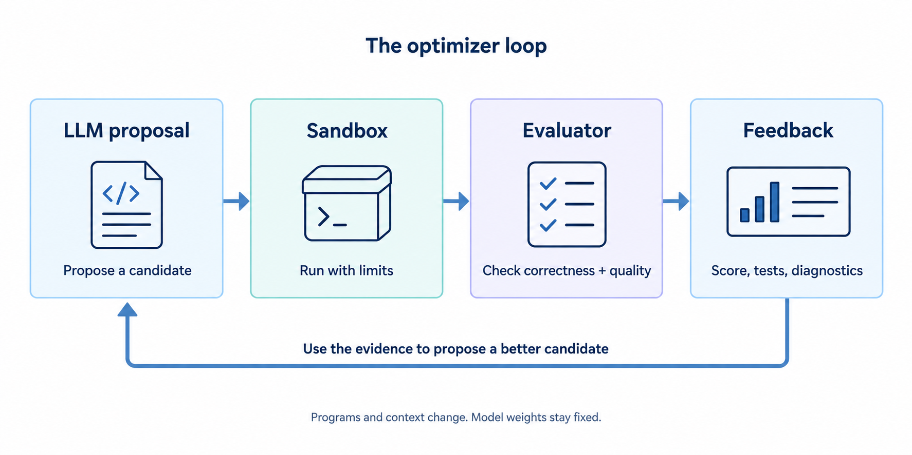
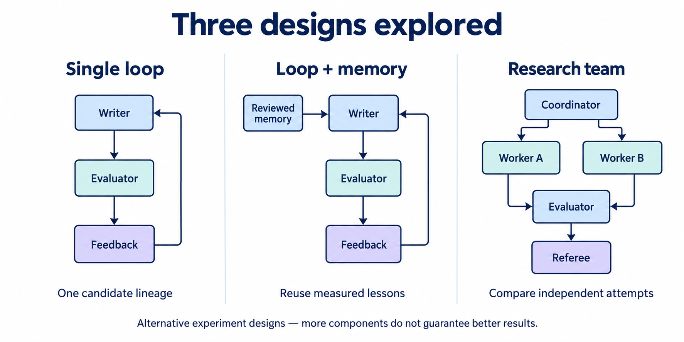
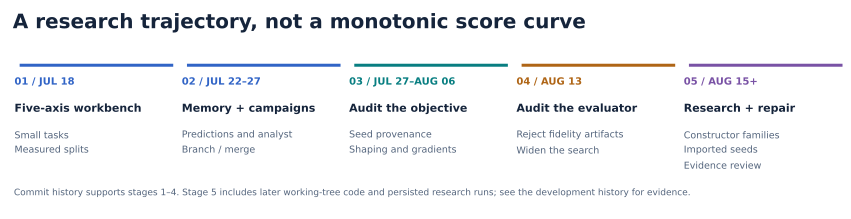
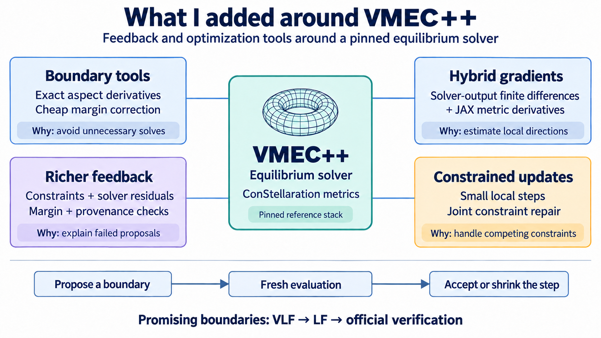

# EvoHarness


<p align="center">
  <a href="#the-idea">The idea</a> ·
  <a href="#what-i-tested">Experiments</a> ·
  <a href="#what-the-experiments-showed">Results</a> ·
  <a href="#the-vmec-case-study">VMEC++</a> ·
  <a href="#where-this-goes-next">Next steps</a>
</p>

I built EvoHarness to investigate **how LLM-based optimizers discover better executable solutions**: what feedback they need, how they retain knowledge, and when branching or specialist agents help.

The starting points were [AlphaEvolve](https://arxiv.org/html/2506.13131v1), [OpenEvolve](https://github.com/algorithmicsuperintelligence/openevolve), and [KernelEvolve](https://arxiv.org/html/2512.23236v4). Earlier work in [EvoRetrieve](https://github.com/timbtz/RL-on-codefunction-in-a-GraphRAG), using STaRK-PRIME retrieval tasks and a DAG executor, led me toward a reusable workbench for comparing these architectures.

> **The research question:** Can a model turn measured feedback into useful novelty—and can the evaluator tell a real improvement from an apparent one?

<a id="optimizer-lineage"></a>

## The idea



A candidate might be a packing heuristic, a routing algorithm, a C kernel, or a program that searches stellarator shapes. Its score, test results, and diagnostics become context for the next model call. **Programs and context evolve; the LLM's weights stay fixed.**

Fast evaluation makes repeated search affordable. [KernelBench](https://github.com/ScalingIntelligence/KernelBench) illustrates the GPU version: generated kernels need correctness checks and timing on the target hardware. My experiments used CPU evaluators, including VMEC++, within limited compute and model-access budgets.

<a id="architecture"></a>
<a id="tasks-and-score-contracts"></a>

## What I tested



I varied **feedback, acceptance rules, search, knowledge, and model roles**. The first bin-packing screen covered **32 configurations × 3 seeds**. Later experiments added persistent memory, analyst/refiner roles, branch merging, and a research coordinator.

| Fast architectural probes | Harder optimization | Scientific evaluation |
|---|---|---|
| Bin packing · 26-circle packing · CPU C kernels | TSP · capacitated vehicle routing (CVRP) | ConStellaration P2 with VMEC++ |
| Short feedback cycles and explicit validity checks | Search under time limits; memory and timing noise | Coupled constraints, solver cost, fidelity, and provenance |

**Memory** retained measured failures and useful mechanisms; curated notes supplied fixed domain knowledge. **Sub-agents** investigated separate hypotheses and reviewed evidence. A **DAG executor** organized dependent branches and handoffs. These additions made experiments more traceable, but did not establish that more agents consistently outperform a single writer.

Most recorded model calls used **Z.ai/GLM through hosted access**. I also used **Claude through subscription-backed CLI access**. Evaluation ran on CPUs; self-hosted model inference and GPU-kernel experiments remain future work.

<a id="current-research-state"></a>
<a id="evidence-from-the-algorithmic-tasks"></a>

## What the experiments showed


The **96-run bin-packing screen** was the most systematic architecture comparison. Its results were task- and budget-dependent: a better average sometimes meant avoiding regression, rather than generating improvements. TSP showed different search behavior. Circle packing has a preserved evaluator, but no historical optimization ledger.

The CVRP memory result is a **single-seed case study**, affected by shared history and runtime noise. The C-kernel speedup is against a **naive baseline**. The stellarator gain is a **local refinement of an inherited design**.

<a id="how-the-project-evolved"></a>



The strongest lesson was that **better experimental controls mattered as much as a more elaborate optimizer**. Equivalent code, stale memory, tolerance consumption, and coarse solver artifacts each changed how I evaluated progress.

<sub>Scientific evidence reviewed 2026-09-17; inventory refreshed 2026-09-21. [Benchmark evidence](reports/data/benchmark-evidence.json) · [Stellarator evidence](reports/data/stellar-evidence.json) · [Full research notes](reports/research-notes.md)</sub>

<a id="stellarator-evidence-in-depth"></a>

## The VMEC++ case study

I extended the **evaluation interface and research loop around [ConStellaration](https://github.com/proximafusion/constellaration) and [VMEC++](https://github.com/proximafusion/vmecpp)**. The LLM writes an optimizer; that program spends a limited solver budget searching boundary parameters. A returned boundary can then be re-evaluated without candidate code.



### What I added—and what happened

| Change | Why it mattered | Observed outcome |
|---|---|---|
| **Constraint and failure feedback** | Official zero scores and failed solves hide useful information | Exposed individual violations, the limiting constraint, and available force residuals |
| **Geometry tools and hybrid gradients** | Give the optimizer local directions | Exact aspect tools; solver-output finite differences combined with JAX metric derivatives. Polish gained **0.001956 official P2 / 715 solves** |
| **Joint constraint repair** | Improving QI alone could worsen mirror; elongation also blocked repair | Added mirror and approximate elongation gradients, then joint descent. One run reduced violation **0.5585 → 0.4656**, still infeasible |
| **Margin and provenance checks** | Higher scores can spend tolerance or reproduce public seeds | Exposed strong inherited results that were almost collinear with their ancestors |
| **Clean re-evaluation and fidelity promotion** | Cheap screening can reward numerical artifacts | Two **≈ +0.0136** screening gains became **official losses** |
| **Feedback-first prompts and persistent repair** | Long plans had displaced actual measurements | Put recent outcomes, failures, incumbent code, and predictions back into context |

The authoritative stack is **ConStellaration 0.2.6 / VMEC++ 0.4.11**. The gradient service reserves **41 evaluations** at its default size; it is an approximate local tool, not a VMEC adjoint. Final verification uses the same pinned stack. [How the extensions work, why they changed, and what the runs show →](reports/vmec-extensions.md)

### Where the later LLM repair run stopped

> **Worst violation: 0.04070 · required limit: 0.01 · P2: 0**
>
> A separate imported-seed repair campaign reached 569 evaluated proposals. Mirror remained limiting, and objective `L` fell to 3.5815. This frontier is still infeasible and has not been officially re-scored.

Repair, public-seed refinement, and unaided construction answer different questions. The project has demonstrated verified local improvements; **it has not established an independently discovered, officially feasible new stellarator family**.

<a id="research-agenda"></a>

## Where this goes next

**Open-weight models and more controlled compute are the next focus.** Building on the GLM experiments, I want to evaluate self-hosted inference and compare model sizes, feedback designs, and agent roles under matched budgets.

| Open question | Next experiment |
|---|---|
| **Useful novelty** | Separate independent constructors from inherited seeds; check behavior, lineage, feasibility, and quality together |
| **Reward hacking** | Re-evaluate promising and rejected candidates at fixed fidelity; retain all failures |
| **Better feedback** | Compare scalar, constraint, memory, and gradient feedback with isolated context and equal solver resources |
| **Compute scaling** | Vary inference budget, solver budget, and branch count separately; measure verified improvement and cost across seeds |

More compute may support deeper search and stronger verification. **A scaling law for discovery remains a hypothesis to test.** For stellarators, the immediate target is to reduce mirror violation without sacrificing the repaired constraints or further collapsing `L`.

<a id="install-and-inspect"></a>
<a id="reproducibility-and-evidence-policy"></a>

## Explore or run

<p>
  <a href="reports/index.html"><strong>Evidence explorer ↗</strong></a> &nbsp; · &nbsp;
  <a href="reports/research-notes.md"><strong>Research notes & setup ↗</strong></a> &nbsp; · &nbsp;
  <a href="configs/"><strong>Experiment configs ↗</strong></a>
</p>

```bash
uv sync --group dev --group analysis
uv run evoharness doctor
uv run evoharness run --config configs/binpacking.json --dry-run
```

Python 3.11+ is required. Set provider credentials before a model run; CVRP and stellarator workflows require their task-specific environment. [Full setup and commands](reports/research-notes.md#8-running-and-inspecting-the-project)

<sub>[Source attribution](NOTICE.md) · [Illustration prompts and provenance](reports/data/visual-provenance.json). Conceptual diagrams use image generation; numeric figures are generated from recorded evidence.</sub>
