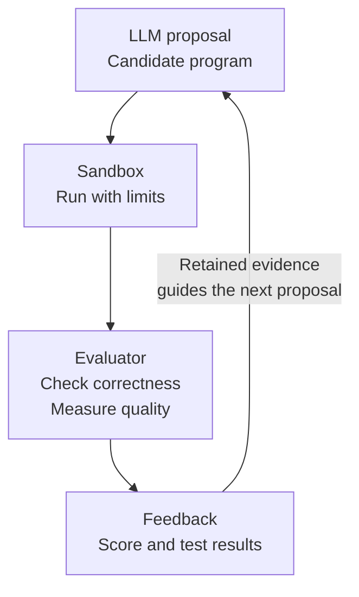
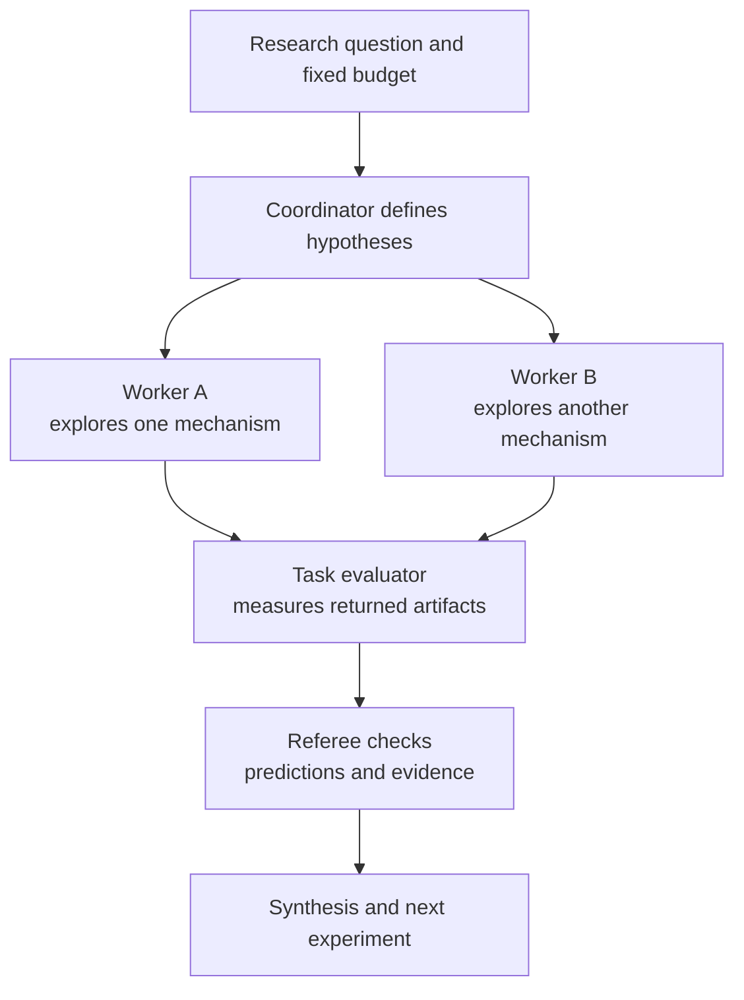
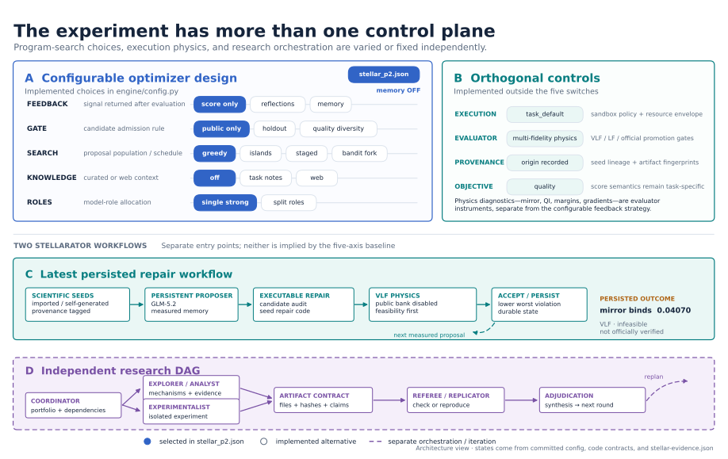
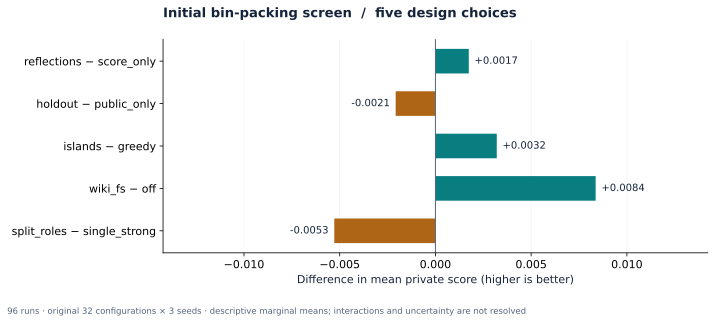
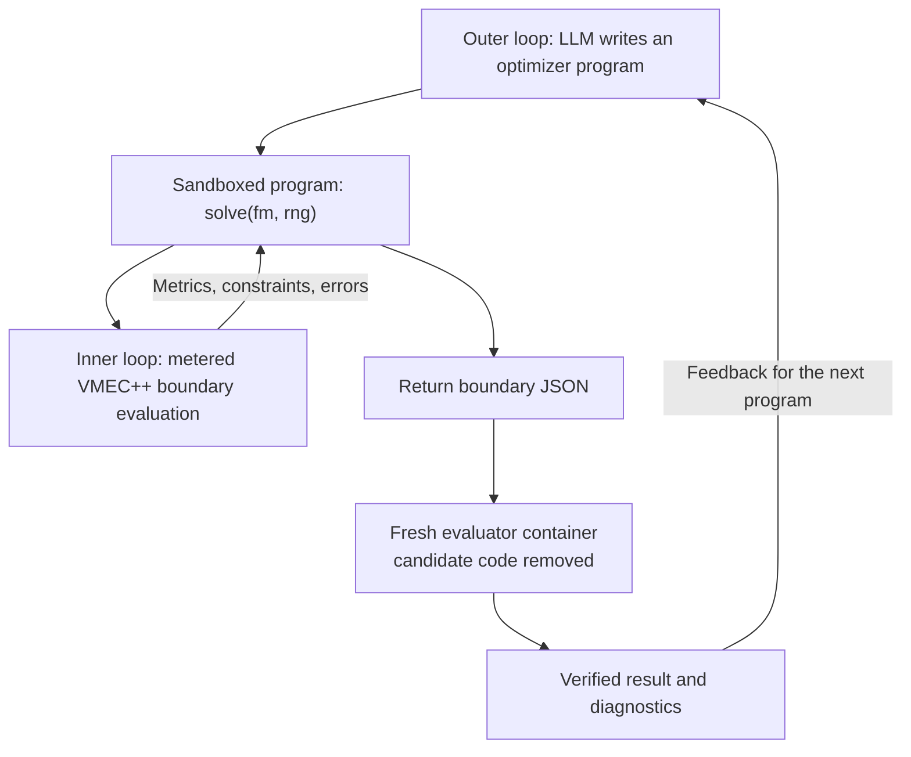
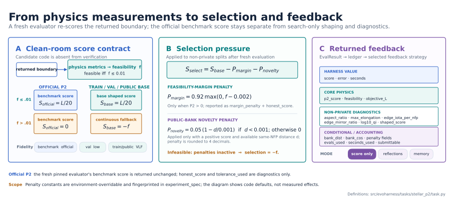
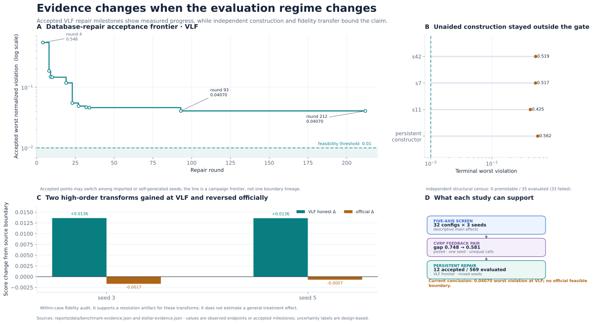

# EvoHarness


**Research into how language models, search, memory, and evaluators can work together to discover better executable solutions.**

[Motivation](#1-research-motivation) · [The optimizer loop](#2-how-the-optimizer-works) · [Architecture experiments](#4-architecture-designs-i-explored) · [Results](#5-results-and-research-trajectory) · [VMEC++ extensions](#6-extending-the-constellarationvmec-evaluator) · [Run the project](#8-running-and-inspecting-the-project) · [Future work](#9-continuing-the-research)

## 1. Research motivation

I started this project to understand **which parts of an LLM-driven optimizer actually make it better at finding new solutions**. Systems such as AlphaEvolve, FunSearch, OpenEvolve, and KernelEvolve suggest a powerful approach: let a model propose executable ideas, test those ideas, and use the results to guide the next proposal. My interest was in the architecture around the model: what it sees, what it remembers, how it explores, and how it knows whether an apparent improvement is real.

I built EvoHarness as a workbench for comparing those choices. I began with small, CPU-evaluable problems so I could run repeated experiments on limited hardware, then extended the work to constrained stellarator design using ConStellaration and VMEC++. The project grew from a configurable optimization loop into experiments with persistent memory, specialist agents, branching search, physics feedback, and clean re-evaluation of returned artifacts.

Earlier, in [EvoRetrieve](https://github.com/timbtz/RL-on-codefunction-in-a-GraphRAG), I explored related ideas by evolving retrieval code against [STaRK-PRIME](https://github.com/snap-stanford/stark), a benchmark combining text and graph retrieval. Those experiments included a DAG executor that chained and merged search branches. EvoHarness turns that architectural interest into explicit comparisons across multiple tasks. Retrieval is part of the research background, rather than a seventh task in this package.

Three questions connect the work:

- **Novelty:** How can the search produce a useful new method or design instead of a cosmetic rewrite or a small variation of an inherited solution?
- **Evaluator design:** Which scores, diagnostics, failures, and gradients help the next proposal improve?
- **Reward hacking:** How can I distinguish a real gain from overfitting, tolerance consumption, timing noise, or a numerical artifact?

The current contribution is a working research system, documented architecture experiments, and an evidence trail of both improvements and failures. The stellarator experiments have produced verified local refinements of inherited designs; they have **not yet established an independently discovered, officially feasible new stellarator family**.

<a id="optimizer-lineage"></a>

### Research and implementations that informed the project

These systems informed different parts of the design. EvoHarness is an experimental synthesis; I did not reproduce their full infrastructure or run a head-to-head benchmark against them. [NOTICE.md](NOTICE.md) records code adaptations separately from design references.

| Reference | Relevant architectural idea | Connection to EvoHarness |
|---|---|---|
| [AlphaEvolve](https://arxiv.org/html/2506.13131v1) | Model-generated programs, executable evaluation, and a retained population | The overall propose–evaluate–select pattern and evaluator-throughput question |
| [FunSearch](https://github.com/google-deepmind/funsearch) and [EoH](https://github.com/FeiLiu36/EoH) | Program evolution, islands, population selection, and algorithmic representations | Bin-packing representation, island search, uniqueness, and parent-selection patterns |
| [OpenEvolve](https://github.com/algorithmicsuperintelligence/openevolve) | An accessible implementation of evolutionary program search | Archive design reference and an attributed adaptation of the circle-packing evaluator |
| [ReEvo](https://github.com/ai4co/reevo) | Short- and long-term reflection on evaluated algorithms | Feedback that explains differences between candidates |
| [KernelEvolve](https://arxiv.org/html/2512.23236v4#S3.SS2) | Context-memory and deep-search sub-agents, execution diagnostics, and a filesystem knowledge base | Curated task knowledge, retained failure evidence, and bounded retrieval |
| [ShinkaEvolve](https://github.com/SakanaAI/ShinkaEvolve) | Novelty filtering, model selection, and meta-recommendations | A design reference for search diversity and memory organization |
| [GigaEvo](https://github.com/FusionBrainLab/gigaevo-core) / [kernel-evo](https://github.com/AXXX-Institute/kernel-evo) | Dependency-graph execution and a kernel-optimization application with evaluation feedback | Campaign orchestration, archives, and separation of execution from stored evidence |
| [KernelBench](https://github.com/ScalingIntelligence/KernelBench) | Correctness checks and repeated runtime measurements for generated GPU kernels | An evaluation reference: speedup must be assessed after correctness on the target hardware |

Reflective memory and held-out acceptance also drew on [SkillOpt](https://microsoft.github.io/SkillOpt/). KernelBench is a benchmark; it supplies an evaluation setting for optimizer research. The C-kernel task here is a CPU experiment, not a KernelBench GPU result.

## 2. How the optimizer works

The simplest version starts with an LLM proposing a candidate program. The program runs under execution limits, the evaluator checks its output, and the next model call receives the result.



| Step | What happens |
|---|---|
| **Propose** | The model receives the task, a starting solution or parent, and available feedback. It proposes a replacement program or optimizer. |
| **Execute** | Candidate code runs with time and resource limits. A failure or timeout is also an experimental result. |
| **Evaluate** | Task-owned code measures correctness, feasibility, and quality: valid routes, matrix error, runtime, or physical constraints. |
| **Return feedback** | The next call may receive a scalar score, per-test diagnostics, comparisons, a reflection, or retrieved memory. |
| **Select and repeat** | A search policy decides which candidates survive and which lineage to explore next. The selected artifact is checked under the final evaluation contract. |

“Learning from feedback” here means changing the next prompt, candidate, or archive. **The proposing model's weights remain fixed.** The loop can improve software used in model training: AlphaEvolve reports improvements to training infrastructure. That is a separate claim from training the proposing model itself. [AlphaEvolve applications](https://deepmind.google/blog/alphaevolve-a-gemini-powered-coding-agent-for-designing-advanced-algorithms/)

### Why the evaluator determines what is practical

Each proposal costs model inference **and** evaluation. A small routing heuristic can be tested on CPUs; a GPU kernel needs correctness and timing measurements on an appropriate GPU; a proposed training method may require a training run before its quality is known. Fast, informative evaluation allows more refinement within a fixed budget. AlphaEvolve uses staged evaluation to reject weak candidates before expensive tests. [Evaluation design](https://arxiv.org/html/2506.13131v1#S2.SS4)

This led me to study the loop first on inexpensive tasks, then ask how it changes when evaluation becomes a constrained physics solve. A richer prompt cannot compensate for an evaluator that rewards the wrong behavior.

<a id="tasks-and-score-contracts"></a>

## 3. Tasks, models, and compute constraints

### From fast checks to scientific evaluation

I chose tasks with different representations and failure modes while keeping evaluation possible on the available CPU server. The early benchmarks support short iterations. CVRP and especially VMEC++ make evaluation cost part of the research question.

| Task | What the model produces | What the evaluator measures | Why I included it |
|---|---|---|---|
| **Online bin packing** | An item-to-bin priority function | Excess bins above a lower bound | Cheap architectural comparisons; exposes equivalent formulas and stagnation |
| **26-circle packing** | Circle positions and radii | Sum of radii after containment and overlap checks | Geometric construction with explicit validity |
| **Traveling Salesperson Problem (TSP)** | A tour constructor followed by fixed 2-opt | Tour-length gap to the split's reference | Transfer of search choices beyond bin packing |
| **CPU matrix multiplication** | A compiled C kernel | Correctness and speedup over a naive kernel in the same binary | Kernel optimization without GPU hardware |
| **Capacitated Vehicle Routing (CVRP)** | A Python policy with optional C local search | Valid capacity-constrained routes and gap to best-known solutions | Harder, time-limited optimization; memory and timing-noise studies |
| **Stellarator design / ConStellaration P2** | A Python optimizer returning a Fourier boundary | VMEC++ equilibrium diagnostics, five constraints, and the P2 objective | Expensive evaluation, physical feasibility, and scientific provenance |

All repository scores are maximized, so some are stored as negative excess or gap. Their units differ; comparisons belong within a task and evaluation contract. [Task implementations](src/evoharness/tasks/) · [Benchmark evidence](reports/data/benchmark-evidence.json)

### Model access and the practical budget

The experiments were shaped by limited compute and model access:

- **Evaluation ran on CPUs.** This made the algorithmic tasks and CPU-based VMEC++ workflows accessible on my server. GPU-kernel benchmarks and large model-training evaluations were outside the available resources.
- **Z.ai/GLM models were used extensively through a hosted endpoint.** The current checked configurations use `glm-5.2` and `glm-4.7` as role settings; these are configuration records, not a ranking of models.
- **Claude was also used through subscription-backed CLI access** for research, critique, and orchestration. Historical subscription calls were not fully priced in the same dollar ledger as hosted model calls.
- **Open-weight models are central to the next phase.** I want to test how far this approach can go with models that can be self-hosted, giving more control over inference capacity, data, and repeated experimentation. The documented runs used hosted access; self-hosted inference remains work to evaluate.

The budget has several dimensions: model calls/tokens, solver calls, elapsed time, CPU resources, and memory. Recorded dollar figures do not represent the full cost of subscriptions and infrastructure. More compute would permit stronger comparisons and more search; whether it reliably improves discovery is an empirical question.

<a id="architecture"></a>

## 4. Architecture designs I explored

### Controlled choices inside the loop

The initial study exposed five binary choices: **32 configurations**. Later work expanded the implementation to the options below. There are now **168 valid combinations**, but that does not mean all have been experimentally compared.

| Design choice | Implemented alternatives | Research question |
|---|---|---|
| **Feedback** | `score_only` · `reflections` · `memory` | Is a score enough, or does interpreting and retaining failures improve proposals? |
| **Acceptance gate** | `public_only` · `holdout` · `quality_diversity` | Should selection use training performance, validation, or a frontier of different behaviors? |
| **Search** | `greedy` · `islands` · `staged` · `bandit_fork` | Does one lineage suffice, or should the budget preserve and revisit alternatives? |
| **Knowledge** | `off` · `task_notes` · `web` | Does domain knowledge help, and how should it enter the context? |
| **Model roles** | `single_strong` · `split_roles` | Where is a more capable model most useful: generation or review? |

`staged` search pushes toward redesign after stalls; `bandit_fork` allocates attempts across branches; quality-diversity selection retains behavioral alternatives. Web knowledge requires the memory path. The [configuration contract](src/evoharness/engine/config.py) and [strategy implementations](src/evoharness/strategies/) define the combinations.

### Context management: from a score to reusable evidence

| Context | What reaches the next proposal | Benefit and failure mode |
|---|---|---|
| **Immediate feedback** | Score, validity, recent parent/candidate comparison | Cheap and direct, but can repeat failed ideas |
| **Curated task knowledge** | Fixed domain notes, evaluator semantics, known hazards | Supplies prior knowledge; must stay fixed in a controlled comparison |
| **Reviewed persistent memory** | Evidence-linked failures, successful mechanisms, code differences, predictions, open questions | Reuses knowledge across runs; can retain stale diagnoses or contaminate comparisons |

KernelEvolve's context-memory and retrieval design was particularly relevant. In EvoHarness, writers read bounded context and a reviewer updates generated memory. Task notes can be injected or accessed through tools. Optional web research passes through the review/memory path. There is no replicated study establishing a general advantage for memory plus web over memory alone.

Several concrete failures changed this design:

- A reviewer trusted a writer's description of its method and preserved a mistaken diagnosis. I added full code or code differences and required coverage of distinct approaches.
- Repeated proposals between reviews motivated a digest of recent attempts.
- Long research plans displaced measured physics outcomes; later prompts put evaluation evidence first.
- Shared memory could leak between comparison arms. Controlled experiments therefore need isolated or frozen snapshots.

Fixed knowledge lives in `src/evoharness/tasks/<task>/resources/knowledge.json`; generated memory lives in `.local/memory/<task>/`. [Memory](src/evoharness/strategies/memory.py) · [Knowledge](src/evoharness/strategies/knowledge.py)

### Sub-agents and the DAG executor

I explored giving agents distinct research responsibilities:

| Role or mechanism | Responsibility | Evidence status |
|---|---|---|
| **Writer / reviewer** | Propose candidates and interpret outcomes | Implemented and used; role splitting was part of the initial screen |
| **Refiner** | Synthesize recent attempts into a revised candidate | Used in later campaigns; no isolated general performance claim |
| **Analyst** | Audit results, investigate failures, suggest directions | Used for research feedback; proposals still require evaluation |
| **Branch workers** | Explore separate hypotheses or lineages, then hand off or merge candidates | Used in restartable campaigns; branch diversity alone did not establish new physics |
| **Coordinator / referee** | Schedule dependent work and check predictions against artifacts | Implemented in the research portfolio; reports count only when their evidence validates |

The **DAG executor** represents dependent work as a directed acyclic graph: explore branches, wait for required results, compare them, and pass selected artifacts to another stage. It organizes a campaign above individual optimizer loops. The historical branch executor ran sequentially under the CPU budget; the research portfolio also supports concurrent workers.



Agent activity and useful output were sometimes very different. One branch ran eight analyst sessions without injecting a candidate because file writes were blocked. Host-side extraction of returned code repaired that handoff. Later review-only multi-agent rounds improved evidence checking but performed no new physics evaluations.

The architecture makes work traceable and supports broader exploration. It also adds model calls and coordination overhead. Existing campaigns do not establish that more agents outperform one writer at equal total budget. [Research store](src/evoharness/research/store.py) · [Portfolio workflow](src/evoharness/tasks/stellar_p2/workflows/research.py)

<details>
<summary><strong>Implementation map and full architecture illustrations</strong></summary>



The blue selections describe the committed stellarator configuration, not a proven optimal architecture.

```text
src/evoharness/
├── engine/        lifecycle, budgets, ledgers, configs, fingerprints
├── strategies/    feedback, selection, search, knowledge, memory, model roles
├── execution/     subprocesses, containers, resource limits
├── research/      hypotheses, evidence contracts, scheduling, handoffs
├── tasks/         six evaluator-owned task packages
│   └── stellar_p2/
│       ├── discovery/   constructors and structural search
│       ├── physics/     score, gradients, fidelity, solver integration
│       ├── workflows/   repair, discovery, factory, polish, verification
│       └── proposals/   optional proposal mechanisms and converters
├── app/           local API and UI
└── analysis/      inventory, reports, figures
```

[Detailed system illustration](reports/figures/architecture.png) · [Optimizer layers](reports/figures/optimizer-layers.png). These two illustrations are AI-generated conceptual views; [visual provenance](reports/data/visual-provenance.json) records their prompts. Result plots are generated from evidence tables.

</details>


<a id="evidence-from-the-algorithmic-tasks"></a>
<a id="current-research-state"></a>

## 5. Results and research trajectory

### Results at a glance

| Experiment | Recorded outcome | What I can conclude |
|---|---|---|
| **Bin packing: 60-call run** | Training excess **4.590% → 1.829%**; selected candidate **1.379% private excess** | The loop improved a heuristic in a small recorded run |
| **Bin packing: architecture screen** | **32 configurations × 3 seeds = 96 runs**, 20 calls each | A replicated descriptive comparison on one task and budget |
| **CPU C kernel: 20-call run** | **16.06× private speedup** over the naive kernel | A correct local improvement; not a comparison with optimized BLAS |
| **CVRP: memory case study** | Private gap **0.748% → 0.581%** between feedback arms | A promising example with noise and shared-history confounders |
| **Stellarator: pinned-solver polish** | Official P2 **0.632082 → 0.634038**, using **715 solves** | A small inherited-basin improvement transferred to official fidelity |
| **Stellarator: structural search** | VLF gains of about **+0.0136** became official losses | Cheap screening can select numerical artifacts |
| **Stellarator: latest repair frontier** | Violation **0.0407015**, versus a **0.01** feasibility limit | Closer to feasibility in the imported-seed arm, still infeasible and not officially verified |

The scientific tables describe the **2026-09-17 evidence review**; the inventory was refreshed on **2026-09-21**. These are dated results, not a live leaderboard. [Benchmark data](reports/data/benchmark-evidence.json) · [Stellarator data](reports/data/stellar-evidence.json) · [Offline evidence explorer](reports/index.html)

### What the small benchmarks taught me



The original bin-packing screen compared all 32 binary configurations across three seeds. This table converts the stored scores into **private excess percentage**; lower is better.

| Change | Mean excess before | Mean excess after | Reading of this screen |
|---|---:|---:|---|
| Score only → reflections | 4.034% | 3.860% | Small descriptive improvement |
| Training gate → holdout gate | 3.843% | 4.051% | Worse descriptive mean at this budget |
| Greedy → islands | 4.107% | 3.787% | Better mean with multiple lineages |
| Knowledge off → task wiki | 4.366% | 3.529% | Better mean, but 43 of 48 wiki runs retained the seed score |
| One strong model → split roles | 3.683% | 4.211% | Worse descriptive mean with split roles |

These are descriptive marginal means; no confidence intervals or interaction estimates were recorded. The task-wiki result illustrates why a better average alone is insufficient: it often reflected avoiding regression rather than discovering improvements.

Other experiments exposed different limits:

- **Bin packing:** complicated formulas often produced the same bin ranking as best-fit. This motivated behavioral novelty, explicit tie feedback, and allowing useful equal-score alternatives to survive.
- **TSP:** the original screen contained 96 runs, one failed endpoint, and 24 runs that stopped early on time. Islands had the opposite descriptive direction from bin packing. A later gate/search probe also showed interactions; there is no task-independent winner.
- **Circle packing:** the evaluator and seed are preserved, but no historical optimization ledger is available. It demonstrates a task contract, not a measured optimizer success.
- **C kernels:** the 16.06× result used private sizes 128 and 512 and a naive baseline timed in the same binary. It does not estimate success probability or hardware portability.

<details>
<summary><strong>CVRP: a useful memory case, and a lesson in measurement</strong></summary>

The closest comparison started from the same ancestor and seed, with holdout selection, staged search, no web knowledge, and a $4 model budget per arm.

| Feedback | Private gap | Model calls | Elapsed |
|---|---:|---:|---:|
| Score only | 0.748% | 96 | 8,405 s |
| Shared memory | **0.581%** | 165 | 5,951 s |

The difference was 0.167 percentage points, or 22.3% of the score-only gap. The memory arm reused known failures and preserved the strong C search kernel while adding a cheap, improving Python polish. However, reviewer calls differed, shared memory matured over time, and the anytime solver was sensitive to host timing.

Repeated private measurements varied by 0.10–0.18 percentage points. I added near-tie re-evaluation, median-based reporting, and validation organized by customers per route rather than instance size alone. This motivated stronger evaluation controls; it does not isolate a causal memory effect.

</details>

<a id="how-the-project-evolved"></a>

### How the research direction changed


| Phase | What I investigated | What changed in the design |
|---|---|---|
| **Initial benchmark study** | Five architectural choices across executable tasks | A common task contract, budgets, candidate history, and private evaluation |
| **Reflection and memory** | Repeated mistakes and context across runs | Reviewed memory, code differences, predictions, and anti-repetition notes |
| **Specialist agents and branching** | Analysts, refiners, restarts, branch merging | Persistent campaign state and evidence-based handoffs |
| **Stellarator score audit** | Strong scores near inherited public boundaries | Margin accounting, normalized novelty descriptors, seed provenance |
| **Physics feedback** | Solver failures, geometric tools, gradients, local polish | Richer diagnostics, metered solver access, constrained local steps |
| **Fidelity correction and repair** | Structural changes and persistent feasibility search | Higher-fidelity checks, feedback-first prompts, separate provenance classes |

The main progression was toward stronger experimental controls. Added complexity did not consistently improve outcomes, and several experiments changed what I considered sufficient evidence for a result.

<a id="stellarator-evidence-in-depth"></a>

## 6. Extending the ConStellaration/VMEC++ evaluator

### The scientific task and the two optimization loops

For the stellarator experiments I used [ConStellaration P2](https://github.com/proximafusion/constellaration), backed by [VMEC++](https://github.com/proximafusion/vmecpp). I extended the **evaluation interface, feedback, tools, and workflows around the solver**. The pinned authoritative environment uses `constellaration==0.2.6` and `vmecpp==0.4.11`. [Evaluator image](src/evoharness/tasks/stellar_p2/Dockerfile.eval)

The model writes `solve(fm, rng)`: a program that proposes and tests Fourier representations of a stellarator boundary, then returns one boundary for clean re-evaluation.



This creates two budgets: model proposals and the solver work inside each proposal. CPU accessibility does not make every evaluation cheap. A gradient estimate can consume many solves, and official verification can cost substantially more than a coarse screen.

### What I added, and why

| Extension | Reasoning | What was added / observed |
|---|---|---|
| **Metered solver access** | An evolved optimizer needs freedom to search without unlimited simulation cost | Solver-attempt limits, elapsed deadlines, timeouts, and recorded counts; failures also consume budget |
| **Feasibility-aware feedback** | Official zero scores hide progress among infeasible designs | Negative worst normalized violation during search, objective `L`, raw metrics, individual constraints, errors, and the active constraint |
| **Clean artifact verification** | Candidate code must not award itself the final score | Re-score only the returned boundary in a fresh evaluator container, without the candidate program |
| **Margin and novelty diagnostics** | Gains may come from spending tolerance or reproducing a known design | Margin penalty, scale/gauge-normalized bank distance, cosine similarity, provenance/export checks |
| **Cheaper nearby evaluations** | Solver latency restricts experimentation | A single-stage path omitting a redundant coarse stage in tested cases; true hot restart was rejected as default because it changed equilibria |
| **Graded solver failures** | Some nonconverged solves contain useful information | Residual-based soft-failure feedback during search, ranked below converged evaluations |
| **Geometry and metric gradients** | Random perturbations ignore available local structure | Exact aspect tools, differentiable metric diagnostics, finite differences through the pinned solver |
| **Fidelity promotion** | Coarse discretizations can reward artifacts | Structural candidates screened at very low fidelity (VLF), promoted to low fidelity (LF), then checked officially |
| **Feedback-first context** | Long plans could displace measured outcomes | Recent measurements, family failure counts, active constraints, incumbent code, and predictions placed before general prose |
| **Persistent repair** | Seed repair and independent construction answer different questions | Named seeds, manifest hashes, evaluator fingerprints, saved attempts, and separate lineage classes |

Implementation: [task/evaluator interface](src/evoharness/tasks/stellar_p2/task.py) · [physics tools](src/evoharness/tasks/stellar_p2/physics/) · [feedback assembly](src/evoharness/tasks/stellar_p2/discovery/evidence.py) · [repair workflow](src/evoharness/tasks/stellar_p2/workflows/repair.py).

### Scores: informative feedback and a fixed final objective

At official fidelity, P2 is `L / 20` only when **all five normalized constraint violations are at most 0.01**; otherwise it is zero. The constraints cover aspect ratio, elongation, rotational transform, mirror ratio, and quasi-isodynamicity (QI).

During search, I exposed the negative worst violation for infeasible candidates. This provides a direction of progress before feasibility. Later experiments also tracked the following margin-adjusted selection diagnostic, called `honest_score` in the code:

```text
honest_score = p2_score - 0.92 × max(0, worst_violation - 0.002)
```

The official score remains unchanged. This diagnostic makes tolerance consumption visible; it does not certify novelty.



The inherited-seed experiments show why this distinction matters:

| Recorded artifact | Official P2 | Worst violation | Interpretation |
|---|---:|---:|---|
| Highest raw legacy score | **0.6420577** | 0.0097398 | Legal score using 97.4% of tolerance; bank cosine **0.999998** |
| Earlier campaign headline | 0.6400196 | 0.0093054 | Near its public ancestor; equal-margin estimate about **0.632** |
| Low-margin inherited ceiling | 0.6344215 | 0.0019244 | More tolerance headroom, still inherited |
| Recorded public reference | 0.6361 | 0.00075 | Used much less of the available tolerance |

The raw record is valid under its pinned evaluator, but near-collinearity with a public seed is weak evidence for a new physical design. Uniform rescaling also initially looked novel in coefficient space, motivating scale-normalized distance.

### Gradient feedback: a useful interface is not yet a better optimizer

I first exposed exact geometry tools for the aspect constraint. They avoid solver calls for information available directly from the boundary. The difficult constraints, however, depend on the equilibrium.

I then added downstream differentiable metrics and finite differences through the pinned VMEC++ solver. This is **not a VMEC adjoint**. A default 20-coefficient central-difference gradient requires 41 solves, so the information has substantial cost.

| Experiment | Outcome | Lesson |
|---|---|---|
| **Aspect-only gradient A/B** | Two paired margin-adjusted deltas had opposite signs: **−0.00199 / +0.00288**; three of five arms kept their seed | No consistent benefit established; the tool addressed only one constraint |
| **Pinned-solver finite-difference polish** | **17 steps / 715 solves**; official **0.632082 → 0.634038**; violation **0.004728 → 0.004361** | A small local improvement transferred to official evaluation |
| **Full-gradient access for an LLM writer** | **18 of 49** candidates called `metric_grad`; the run retained its starting boundary | Tool availability and adoption do not establish better search |
| **Different-solver gradient proposals** | VMEC++ 0.7.1 sidecar derivatives did not reliably descend the pinned 0.4.11 objective | Proposal tools may differ; the fixed evaluator decides which gains count |

Local step size mattered: predictions were useful around coefficient changes of `1e-5`; changes near `1e-4` could switch the active grid minimum. Smoothing to support larger steps introduced bias comparable to the desired gain.

The successful polish eventually stalled. Records disagree on the decisive explanation—constraint projection versus a search-margin penalty—and later evidence challenged the margin explanation. The supported finding is a modest, verified local gain followed by a stall. [Finite differences](src/evoharness/tasks/stellar_p2/physics/finite_difference.py) · [Metric tools](src/evoharness/tasks/stellar_p2/physics/metrics/)

### Fidelity: a better screening score became a worse result

Two high-order structural transformations initially looked substantially better at VLF:

| Transform | Change in VLF margin-adjusted score | Change in official score |
|---|---:|---:|
| Band seed 3 | **+0.013634** | **−0.001663** |
| Band seed 5 | **+0.013603** | **−0.000706** |

Higher-fidelity evaluation reversed the conclusion. After the correction, 56 inherited candidates were evaluated, six were officially confirmed, and two beat their source officially. The best official improvement was only **+0.0001831**.

This was a central finding: an optimizer can successfully maximize a screening objective while exploiting its numerical resolution. More search against that objective can strengthen the apparent result without improving the underlying design.

### Later runs: better context, persistent repair, and the remaining gap

One context failure was particularly instructive: a campaign placed a roughly 26,000-character plan before the evidence, then truncated the context at 12,000 characters. Measured physics outcomes never reached the writer. I changed context assembly to put measurements and failure summaries first. This repaired information flow; it was not a controlled demonstration of a score gain.

The later repair workflow also retained incumbent code, recent attempts, named seed provenance, and explicit **Idea / Prediction / Memory** fields. It keeps a persistent account of what was measured and which constraint is limiting.



The latest persisted repair run used declared scientific-database or self-generated seeds with the public leaderboard bank disabled:

| Measure | Recorded state |
|---|---:|
| Rounds / evaluated proposals | 694 / 569 |
| Evaluation failures / proposal failures | 123 / 2 |
| Accepted events | 12 |
| Best worst normalized violation | **0.0407015261** at VLF |
| Required feasibility limit | **0.01** |
| Limiting edge mirror ratio | **0.2081403**, against a **0.2** bound |
| Objective `L` / P2 | **3.58147 / 0** |
| Official re-evaluation | **Not performed for this frontier** |

The meaningful frontier was already reached at round 93. The nominal best at round 212 improved violation by only about `8.6e-12`; that is not substantive progress. The run exhausted its cumulative 3,000-call limit at call 3,001.

Repair moved closer to feasibility but sacrificed performance: even if this boundary became feasible at the same `L`, P2 would be only about **0.179**. The next step must preserve the repaired constraints while recovering performance.

The provenance classes must remain separate:

- **Unaided construction:** the best initial stochastic attempt reached violation **0.4253**, still with P2 zero. Later independent structural census work produced **zero promotable leaders** from 68 jobs: 35 evaluated and 33 failed.
- **Public-seed refinement:** produced the official local gains above, with inherited ancestry.
- **Scientific-seed repair:** reached the **0.04070** VLF frontier. Disabling the public bank does not remove ancestry from imported configurations.

The repair milestones can switch between seeds. They are selected accepted observations, not a single boundary's learning curve. [Plot data](reports/data/design-view.json) · [Detailed evidence](reports/data/stellar-evidence.json)


## 7. Novelty, reward hacking, and what counts as evidence

### Can novelty be ensured?

There is no general novelty guarantee from an evolutionary loop. A different program can implement the same behavior; a different coefficient vector can describe essentially the same geometry; an apparently independent result can depend on imported seeds or accumulated memory.

I therefore treat novelty as a claim requiring several kinds of evidence:

| Question | Current approach | Remaining limitation |
|---|---|---|
| **Is the behavior different?** | Behavioral comparisons, tie handling, quality-diversity archives | Different behavior can still be worse or uninteresting |
| **Is the design structurally different?** | Normalized coefficient distances, cosine similarity, typed structural mechanisms | Distance alone does not establish a new physical mechanism |
| **Where did it come from?** | Seed manifests, parent history, public-bank access, scientific-data provenance | A bank blackout does not erase imported ancestry |
| **Is the gain real?** | Held-out checks, repeated timing, clean artifact re-evaluation, fidelity promotion | Same-stack verification is not independent-solver validation or external replication |

The goal is a useful, verified improvement with an inspectable origin. Novelty pressure should preserve promising alternatives without rewarding arbitrary distance from good solutions.

### How I reduced misleading rewards

| Failure mode observed | Response in the research system |
|---|---|
| Equivalent bin-packing formulas appear new | Compare behavior and make ties explicit |
| CVRP timing variation looks like progress | Re-evaluate near ties and report repeated measurements |
| Candidate code influences its own reported result | Let trusted task code validate outputs; re-score stellarator boundaries without candidate code |
| A stellarator consumes almost all feasibility tolerance | Report raw constraints and margin-adjusted diagnostics alongside official P2 |
| A coarse solver rewards high-order artifacts | Promote through fixed higher-fidelity evaluations |
| A reviewer preserves an unsupported explanation | Give it code, measurements, and source artifacts; require evidence before accepting the claim |
| A busy campaign produces no new measurements | Count evaluated artifacts, failures, and verified outcomes separately from calls or agent sessions |

These controls reduce particular failure modes; they do not make reward hacking impossible. The evaluator's design remains part of the research.

For stellarator claims, I retain at least:

```text
official score · objective L · constraint violations · fidelity
evaluator fingerprint · seed/parent provenance · bank distance/similarity
solver and model budgets · repeated-evaluation status
```

<a id="install-and-inspect"></a>

## 8. Running and inspecting the project

### Quick start

Python 3.11+ and `uv` are required:

```bash
uv sync --group dev --group analysis
uv run evoharness doctor
uv run evoharness tasks
uv run evoharness axes
```

Copy `.env.example` to `.env` and set the provider key required by the selected model before a model run. The main loop uses `ZAI_API_KEY`. Seed-only or zero-model-call configurations need no provider key. `doctor` reports optional runtime dependencies separately.

Inspect a configuration before running it:

```bash
uv run evoharness run --config configs/binpacking.json --dry-run
```

Then run the chosen task:

```bash
uv run evoharness run --config configs/binpacking.json
```

The six checked configurations are in [configs/](configs/). TSP and CVRP datasets are downloaded explicitly:

```bash
uv run evoharness fetch tsp
uv run evoharness fetch cvrp
```

These datasets live under `.local/data/`. For the UI and analysis entry points:

```bash
uv run evoharness serve
uv run evoharness report --help
uv run evoharness screen --help
uv run evoharness inventory
```

The [offline evidence explorer](reports/index.html) opens without an application server.

### Reproduce an architectural choice

Copy a configuration and vary the intended factor while holding the other settings fixed. For example:

```bash
uv run evoharness run --config configs/binpacking.json \
  --set switches.feedback=memory \
  --set switches.knowledge=task_notes \
  --dry-run
```

Remove `--dry-run` to execute. Use separate `EVOHARNESS_HOME` directories or frozen memory snapshots for controlled comparisons.

<details>
<summary><strong>Additional model, memory, and execution controls</strong></summary>

| Control | Setting |
|---|---|
| Model identities | `--set models.strong=MODEL` / `--set models.cheap=MODEL` |
| Refiner | `--set refiner=MODEL` / `--set refiner_every=5` |
| Analyst | `--set analyst=MODEL` / `--set analyst_every=10` |
| Analyst research / candidate injection | `--set analyst_web=true` / `--set analyst_inject=1` |
| Memory review cadence | `--set review_every=20` |
| Resume / second parent | `--set resume_from=RUN_ID` / `--set merge_from=RUN_ID` |
| Stall limit | `--set stall_stop=20` |
| Require container execution | `--execution require_container` |

Task-default execution uses temporary subprocesses or task-specific containers. Subprocess limits are suitable for cooperative research code; they are not a hostile multi-tenant security boundary. Container evaluators add network removal, capability restrictions, resource caps, and reproducible dependencies.

The generic evaluator image can be built in advance:

```bash
docker build -t evoharness-benchmark-eval \
  -f src/evoharness/execution/Dockerfile.eval \
  src/evoharness/execution
```

The root `Dockerfile` and `compose.yml` provide a lightweight UI/runtime deployment without mounting the host Docker socket. Run CVRP, stellarator, and required-container experiments from a host CLI with Docker daemon access.

</details>

### Run the stellarator workflows

Prepare the pinned evaluator on a Docker-capable host:

```bash
docker build -t evoharness-stellar-eval \
  -f src/evoharness/tasks/stellar_p2/Dockerfile.eval \
  src/evoharness/tasks/stellar_p2
```

| CLI workflow | Purpose |
|---|---|
| `stellarator repair` | Repair declared, provenance-tagged scientific seeds |
| `stellarator discover` | Independent construction with public-bank blackout |
| `stellarator research` | Coordinate hypotheses, worker tasks, and evidence review |
| `stellarator evaluate` | Re-score a saved boundary without proposal code |
| `stellarator factory` | Search constructor recipes |
| `stellarator polish` | Apply trusted local improvement |
| `stellarator export` | Package a checked artifact with lineage and metadata |

Each command exposes its arguments through `--help`. For example, inspect the repair prompt without a model call:

```bash
uv run evoharness stellarator repair \
  --run-dir .local/runs/repair-next \
  --seed-dir .local/runs/repair-seeds \
  --rounds 10 --max-calls 50 --max-usd 2 --walltime-hours 1 \
  --print-prompt
```

The seed database is local research data; a fresh clone must supply provenance-tagged boundary JSONs through `--seed-dir`. Removing `--print-prompt` executes the experiment. Reusing a run directory resumes its cumulative budget and state; use a new directory when changing the seed manifest or evaluator contract.

<details>
<summary><strong>Physics controls and a coordinator/worker example</strong></summary>

Set physics environment variables before starting the process; task import captures several of them. The experiment specification records their effective values.

| Control | Setting | Meaning |
|---|---|---|
| Public bank blackout | `STELLAR_NO_BANK=1` | Disable public-bank access; imported scientific seeds retain ancestry |
| Inner search budget | `STELLAR_TRAIN_OVERRIDES='{"max_evals":160,"cpu_budget":480.0,"eval_timeout":180.0}'` | Solver-attempt and time limits; the historical `cpu_budget` parameter enforces an elapsed-time deadline |
| Geometry tools | `STELLAR_MARGIN_GRAD=1` | Expose boundary-only aspect/margin tools; default enabled |
| Solver metric gradients | `STELLAR_FULL_GRAD=1` | Enable the pinned finite-difference/JAX service; default disabled |
| Training fast path | `STELLAR_HOT_RESTART=0` | Disable the fast path; the enabled default uses single-stage evaluation, not true equilibrium reuse |
| Nonconvergence feedback | `STELLAR_SOFT_FAIL=0` | Remove graded soft failures for a control arm |
| Margin shaping | `STELLAR_MARGIN='{"target":0.002,"slope":0.92}'` | Penalize tolerance consumption during selection |
| Novelty shaping | `STELLAR_NOVELTY='{"min":0.003,"pen":0.05}'` | Bank-distance shaping; no guarantee of independence |
| Container memory | `STELLAR_MEM_MB=4096` | Set the candidate memory limit; gradients may require more |

Persistent workflows set inner budgets from their own flags. Keep model settings, memory, seed origin, fidelity, solver image, and thread policy fixed within a comparison.

A bounded coordinator/worker run can be configured as follows:

```bash
uv run evoharness stellarator research \
  --run-dir .local/runs/research-next \
  --coordinator zai --disable-backends claude,codex \
  --tasks 4 --workers 2 --rounds 1 --total-budget-usd 2
```

The Z.ai backend reasons over supplied evidence without repository shell tools. Claude/Codex backends can inspect the repository and use separately authenticated CLIs. `--plan-only` still calls the coordinator and is not a free dry run.

</details>

<a id="reproducibility-and-evidence-policy"></a>

### Evidence and reproducibility

| Location | Contents |
|---|---|
| [reports/data/](reports/data/) | Committed evidence summaries, inventory, and plot data |
| [reports/figures/](reports/figures/) | Research diagrams and generated result plots |
| `.local/runs/` | Raw ledgers, configurations, candidates, state, evaluator artifacts |
| `.local/memory/` | Generated task memory and snapshots |
| `.local/data/` / `.local/reference/` / `.local/external/` | Downloaded instances, reference material, external tools |
| [tests/](tests/) | Engine, execution, task, research, and physics checks |

Raw local data and mutable memory are intentionally untracked. A fresh clone includes the reviewed summaries, not every historical conversation or candidate. Some historical source paths in the evidence manifests use the pre-refactor layout.

The 2026-09-21 inventory recorded **337 JSONL ledgers, 107,186 rows, 141 run groups, and zero malformed rows**. All 8,924 rows added since the September 17 review were factory `llm_error` events, not new physical results.

The recorded package validation on September 21 was **119 tests passed, 2 skipped**. That is a historical validation result, not a claim that a new physics campaign has been run for this documentation update.

```bash
uv run pytest
uv run --group analysis evoharness figures
uv run evoharness inventory --exclude-family docs-smoke-check
```

`figures` rebuilds data-driven assets; the two AI-generated conceptual illustrations are retained separately. Exact replay is limited by model sampling, hardware timing, external dependencies, and provider behavior. A defensible comparison still requires pinned inputs and evaluators, isolated memory, all failures in the denominator, and final verification. Budget checks occur between operations, so an in-flight call can cross a nominal limit.

<a id="research-agenda"></a>

## 9. Continuing the research

### A clearer experimental design before larger campaigns

The next phase should test a smaller number of explicit hypotheses with repeated seeds, fixed evaluators, and matched resources. I want to measure **verified improvement per unit of model and evaluator compute**, alongside diversity and failure rate.

| Question | Planned comparison | Evidence of progress |
|---|---|---|
| **Does richer feedback help?** | Scalar versus constraint diagnostics versus gradients, with the same initialization and solver budget | Better official outcomes across seeds after including gradient cost |
| **Does memory transfer useful knowledge?** | No memory, frozen knowledge, evolving memory; isolated writes | Less repeated failure and better held-out results, with stale-memory cases recorded |
| **Do sub-agents justify their cost?** | One writer versus coordinator/workers/referee at equal total budget | More verified improvements or resolved hypotheses per unit of compute |
| **Does novelty pressure find useful alternatives?** | Explicit diversity policy versus score-only selection, with provenance classes kept separate | Distinct feasible designs or behaviors that retain quality under verification |
| **Does cheap screening transfer?** | Re-score selected and rejected samples at fixed official fidelity | Stable rankings and a measured rate of misleading screening gains |

### Open-weight models and self-hosting

My intended direction is to rely more heavily on **open-weight models that can be self-hosted**, building on the extensive use of Z.ai/GLM in this project. Self-hosting would make inference capacity and deployment behavior explicit experimental variables and could support longer-running research without depending entirely on subscription limits.

The first comparison should hold the task, context, search policy, and evaluator fixed while changing model access or model size. I would record model/checkpoint identity, inference settings, throughput, full compute cost, and verified task outcomes. Claude can remain a comparison or specialist option. The question is whether an affordable, reproducible open-weight setup can deliver useful discovery across repeated experiments.

### More compute: test scaling rather than assume it

A scaling relationship is a hypothesis for future work. The current experiments do not establish a scaling law for novelty or verified solution quality.

I would vary the relevant resources separately:

- **Inference budget:** more proposals, different model sizes, and different generation/review allocations.
- **Evaluation budget:** more CPU solver calls, higher-fidelity checks, and repeated measurements.
- **Search breadth:** more independent seeds and branches, with total resources matched against deeper sequential search.
- **GPU access:** self-hosted inference and, where appropriate, a dedicated KernelBench-style kernel experiment with correctness and target-device timing.

The resulting curves should report verified quality and diversity against tokens, solver work, elapsed time, and cost, including failed runs and uncertainty. This would show whether additional compute buys progress, reaches a plateau, or mainly produces more opportunities to exploit the evaluator. GPU availability alone should not be assumed to accelerate the existing CPU physics workflow.

### The next stellarator milestone

The immediate scientific step is to address the repair frontier's mirror violation while preserving its other constraint gains and preventing further collapse of `L`. Surviving candidates should pass LF and official evaluation before the search expands.

From there, the target is an **officially feasible, provenance-complete artifact with useful performance**, followed by evidence that its mechanism or design is meaningfully different from inherited seeds. Keeping feasibility repair, performance improvement, and independent discovery as separate experiments will make the next phase easier to evaluate—and make any eventual claim of novelty more credible.
