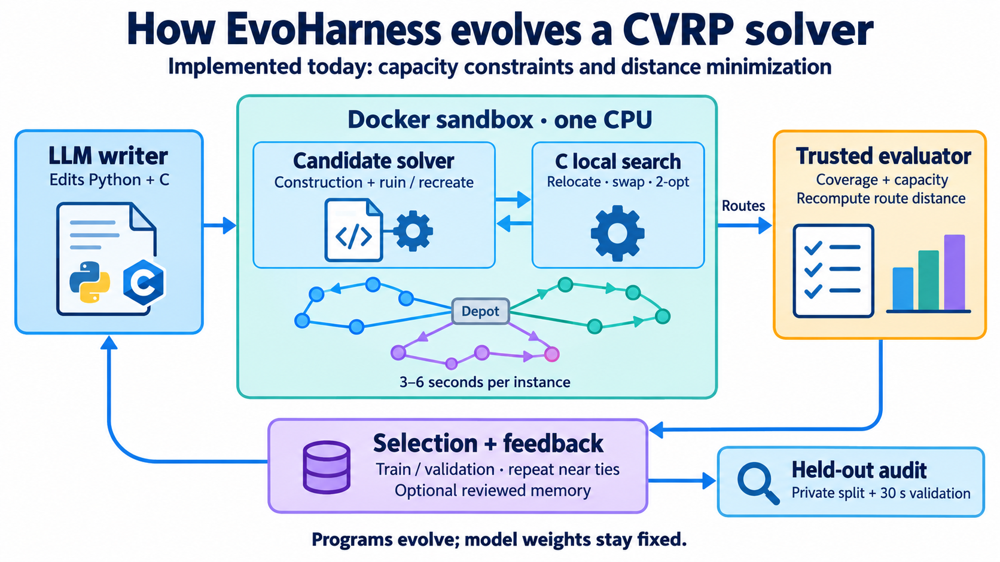
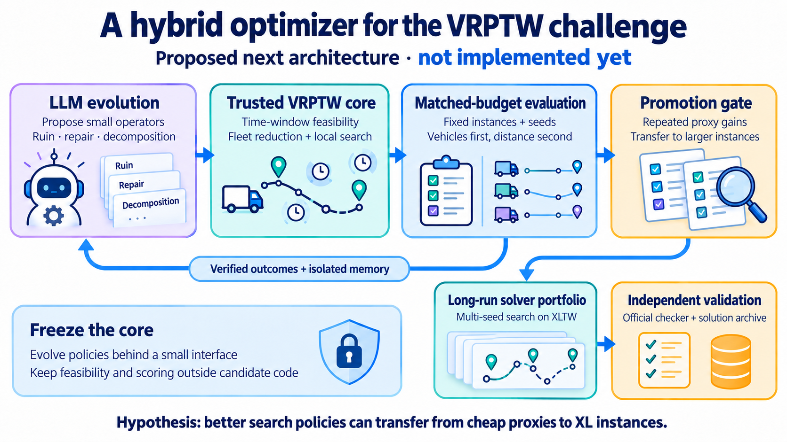

# Routing study: from CVRP program evolution to a VRPTW contribution

Audit: **26 October 2026**. This report separates preserved experiments, current
implementation, new regression measurements, and proposed work. Start with the
[source map and commands](../src/evoharness/tasks/cvrp/README.md).

## Assessment

EvoHarness is a credible **research workbench and small-instance CVRP prototype**.
Its strongest assets are a functioning classical solver, executable candidate
evolution, host-side route validation, experiment ledgers, and an unusually useful
record of failed ideas and measurement problems. It is not yet a VRPTW solver,
an XL-scale solver, or evidence of beating routing best-known solutions.

The promising project-study contribution is to make LLM-designed search policies
work inside a strong, fixed VRPTW solver and measure when those policies transfer.
That gives a student team a useful deliverable even without winning the challenge:
a verified adapter, reproducible baseline, one improved component, and a careful
study of quality, runtime, and scale. Building a whole competitive time-window
solver from this C kernel would put much more of the project at risk.

## What was built and researched

The outer loop evolves **programs**, not model weights or individual vehicle routes.
The LLM receives a parent solver, measured outcomes, and optional reviewed memory,
then proposes a new solver. The inner program constructs and improves routes
under a short deadline. Its output is checked against the original instance.

The reusable research axes are feedback (`score_only`, reflections, memory),
acceptance rules, search organization, knowledge, and model roles. CVRP tested
whether remembering mechanisms and failure modes helps when fitness is expensive,
noisy, and often nearly saturated. This was part of a broader optimizer study;
the most systematic architecture screen was on bin packing, not routing.

The hand-written seed is substantial. Python constructs Clarke–Wright savings
routes and drives an embedded C kernel. The kernel uses nearest-neighbor move
candidates, don't-look bits, relocate, Or-opt, swap, 2-opt, and 2-opt*. An outer
large-neighborhood search uses related/segment removal, regret insertion,
annealing-style acceptance, and best-solution restarts. The model can rewrite
both layers. The successful memory endpoint largely retained this foundation
and added inexpensive Python polishing; it did not invent a routing solver
from scratch.

All scored X instances are small relative to XLTW: the current suite reaches
X-n303 (302 customers plus depot). Scoring minimizes mean percentage distance
gap to fixed references. There is no fleet-first ranking. Standard instance
budgets are 5 seconds for train/validation and 6 seconds for private, plus
`val30` at 30 seconds. Public A/B/P examples are mostly solved to their references
and therefore provide little search signal.

## What the historical results mean

| Program | Provenance | Private gap | Calls |
|---|---|---:|---:|
| Shared ancestor | `cvrp-s0-43507138`, `c0014` | 0.627673% | 29 |
| Score-only endpoint | `cvrp-s3-51556548`, `c0033r1` | 0.747566% | 96 |
| Memory endpoint | `cvrp-s3-45465035`, `c0035` | 0.580664% | 165 |

The paired arms used seed 3, holdout selection, staged search, no external
knowledge, one strong writer, and about $4 each. The endpoint difference was
**0.166902 percentage points**. Relative to the ancestor's single measurement,
memory was only **0.047009 points** better; score-only was **0.119893 points**
worse. These comparisons are descriptive, not causal estimates.

The [reviewed historical evidence](data/benchmark-evidence.json) records the
endpoint study and later runs. Local ledgers include 20 CVRP runs, including
bootstrap, smoke, and unfinished work; this is not 20 independent controlled
studies. Historical source paths are resolved under `.local/` and are not all
available in a fresh clone. We now preserve the relevant frozen programs and
their provenance under [data/cvrp/](data/cvrp/).

Several qualifications change the interpretation:

- **Timing variation is material.** Identical memory code measured roughly
  0.581, 0.636, and 0.680% on private. Another candidate spread across
  0.626–0.809%. These are observed ranges, not confidence intervals.
- **Equal dollars did not mean equal search.** Calls, reviewer overhead, evaluated
  candidates, and solver time differed. Accumulated memory and resumed ancestry
  made runs dependent on their history.
- **The private split was examined.** Its results informed memory and the redesign
  of validation by customers per route. It now measures regression behavior,
  not untouched generalization. The `val30` probe reuses validation instances.
- **Harness seeds are not solver seeds.** The seed solver starts
  `random.Random(0)` on every instance. Wall-clock changes alter the trajectory,
  but changing the evolution seed does not independently seed that solver.
- **Median gates are partial mitigation.** Near-tie acceptance re-runs the child,
  while the parent's stored score can remain lucky. Adaptive selection still
  creates winner's bias; repeated paired evaluation of both programs is stronger.

The earlier assessment's overall caution was justified. Its strongest missing
detail was direct evidence that LLM-evolved components already contributed to
the 2026 CVRP challenge winner. Its claim that a modern baseline necessarily
requires implementing fleet minimization from scratch is also too strong.

## Fresh regression measurements

The new runner compares frozen code sequentially, rotates candidate order, stores
per-instance costs and full-precision gaps, and records source/data/config hashes,
CPU affinity, Docker image ID, errors, and elapsed time. The candidate never supplies
the reported cost. A failed repeat suppresses the headline median. No model calls
are needed for these experiments.

Results are recorded in [the 26 October recheck](data/cvrp/recheck-20261026.json).
The numerical summary below uses completed runs. These runs
test the existing programs on the current machine; they do not reproduce the
historical provider interaction or identify the effect of memory.

| Split | Program | Median gap | Range across three repeats |
|---|---|---:|---:|
| val | seed | 0.6379% | 0.5706–0.7048% |
| val | score_only | 0.4384% | 0.3246–0.4640% |
| val | memory | 0.2349% | 0.1874–0.3076% |
| private | seed | 0.5757% | 0.4466–0.7875% |
| private | score_only | 0.6663% | 0.6575–0.8081% |
| private | memory | 0.6921% | 0.5378–0.7538% |

Each entry is the median of three split mean gaps, with equal weight per instance.
All 18 evaluations succeeded. Memory beat the other frozen programs on validation,
but its historical private advantage did **not** reproduce: the seed had the lowest
private median in this batch. The private ranges overlap substantially, and the
seed's spread reached 0.341 percentage points. This is evidence against treating
the old endpoint ranking as stable; it does not prove one architecture generally
outperforms another. The current environment is a new Docker build, not a replay
of the historical runtime image.

The **30-second validation probe** used one evaluation per program:

| Program | Mean gap at 30 seconds |
|---|---:|
| seed | 0.4480% |
| ancestor | 0.1599% |
| score_only | 0.4782% |
| memory | 0.1596% |

The ancestor and memory endpoint were nearly tied in this single probe; the
score-only endpoint had a larger gap. Do not compare these single observations
as if they had the precision of a repeated experiment. Changing the deadline
also changes the annealing schedule, so a longer run need not follow the same
search trajectory as a short run. [Raw 30-second records](data/cvrp/val30-probe-20261026.json)

A separate **ancestor/private repeat batch** measured:

| Program | Median gap | Range across three repeats |
|---|---:|---:|
| seed | 0.5314% | 0.5291–0.5761% |
| ancestor | 0.6592% | 0.5270–0.7137% |

Keep this batch separate from the endpoint comparison above: it was measured
later and was not part of the same candidate-order rotation. It provides no
clear evidence that the ancestor improves on the current seed under this short
private budget. [Raw ancestor records](data/cvrp/ancestor-recheck-20261026.json)

**Completed workload:** 28 sequential split evaluations, covering 84 instance
solves and 765 nominal instance-budget seconds, plus overhead. All succeeded;
**zero model calls** were made. These were baseline and regression experiments,
not new LLM evolution campaigns.

## Challenge facts and remaining uncertainty

The official VRPTW announcement specifies XLTW with 1,000–10,000 customers and
lexicographic minimization of vehicle count, then distance. Competition dates
are **24 February–26 March 2027, 15:00 GMT**. Detailed rules and XLTW-Test are
scheduled for **28 October 2026**; registration opens 16 December. An optional
algorithm submission for common-budget pre-challenge evaluation is due 16 January
2027 and is separate from competition entry. Exact rounding, file formats, and
technical rules still need checking when released. [Official overview](https://galgos.inf.puc-rio.br/cvrplib/index.php/en/challenges/vrptw/overview)

Do not copy the present CVRP integer-distance convention into a new VRPTW task
without checking those rules. Similarly, a weighted distance penalty for extra
vehicles is not automatically equivalent to lexicographic ranking. Keep the
objective as a pair in evaluation, with any search penalties kept internal.

## Related systems: what they actually demonstrate

| Primary source | Relevant result | Implication and limit |
|---|---|---|
| [2026 CVRPLib organizer report](https://arxiv.org/html/2601.11467v2) | Winner OptVerse-CityU combined EoH-evolved AILS-II components with a broader solver portfolio; third-place Sub-Appro also evolved components. Winner held 51 final BKSs and reported about 42,600 CPU-days. | Direct same-domain precedent. Portfolio, engineering, and compute prevent attributing the outcome solely to LLM evolution. This was CVRP, not VRPTW. |
| [AILS-AHD](https://arxiv.org/html/2602.23092v2) | Evolves ruin heuristics within AILS and reports 8 new BKSs on the 10-instance AGS benchmark (3,000–30,000 customers). | Strong support for evolving a bounded component. AGS is neither the 100-instance XL challenge nor XLTW; the paper does not establish VRPTW transfer. |
| [ReEvo](https://arxiv.org/html/2402.01145v3) | Reflective evolution of heuristics, including CVRP and other combinatorial tasks. | Useful basis for feedback ablations. Its routing experiments do not demonstrate performance on XLTW. |
| [Evolution of Heuristics](https://arxiv.org/html/2401.02051v2) | Evolves heuristic descriptions and code; original tasks include bin packing, TSP and flow-shop scheduling. | Shows an alternative representation for search. The original paper is not a VRPTW competition result. |
| [FunSearch](https://github.com/google-deepmind/funsearch) | Evolved functions for mathematical constructions and online bin packing. | Supports restricting evolution to a small function inside a fixed algorithm. |
| [AlphaEvolve](https://arxiv.org/abs/2506.13131) | Evaluator-guided code evolution for mathematical algorithms and computing infrastructure. | Supports the general architecture; it does not validate this routing implementation. |

Consequently, “apply AlphaEvolve to routing” alone is a weak novelty claim.
A sharper contribution would be **controlled evidence about transfer, feedback,
or component choice in fleet-first large-scale VRPTW**, with a reproducible
implementation and a strong classical comparison.

## Proposed architecture and falsifiable hypotheses

Keep a tested VRPTW core responsible for construction, move feasibility,
fleet reduction, and solution persistence. Let evolution propose one small
component first: customer-removal scores, ruin-size control, acceptance schedules,
or decomposition selection. Use explicit RNG state, bounded inputs/outputs,
timeouts, and a default policy when a proposal fails. Preserve the independent
validator and score comparison outside generated code.

This can work because many useful routing decisions are compact heuristics with
cheap, measurable consequences. A model can combine known ideas or adapt their
formulas, while the fixed solver supplies the expensive search machinery and
correctness. The hard part is credit assignment: a promising idea must beat
ordinary tuning after accounting for timing noise, many attempted candidates,
and the cost of discovering it.

| Hypothesis | Comparison | Evidence that would count against it |
|---|---|---|
| Evolved policies improve search | Fixed core + evolved component versus unchanged core and ordinary parameter tuning | No repeated held-out gain at matched solver and discovery cost |
| Memory improves discovery | Same ancestors, model, instances and budgets; isolated memory per evolution seed | Improvement disappears across independent seeds or after matching evaluations |
| Cheap proxies predict useful XL policies | Freeze winners on smaller instances, then test larger instances and longer budgets | Rank reversal, feasibility loss, or gains vanishing at larger scale |
| A small interface helps | Component evolution versus whole-program evolution | Similar quality with no reduction in invalid proposals, variance, or discovery cost |

Use the number of vehicles as the first comparison key, distance as the second,
and report feasibility failures separately. Include both construction from scratch
and improvement of existing solutions; late-stage BKS hunting is a different
regime from a six-second cold start.

## Contributor plan

| Priority | Concrete work | Completion criterion |
|---|---|---|
| 1. Establish the contract | Read final rules; implement a separate VRPTW parser, service/waiting/depot checks, fleet-first evaluator, and solution export | Tiny adversarial examples and official-format solutions agree with an independent checker |
| 2. Get a baseline | Pin a released solver and dependencies; evaluate fleet reduction and fixed-fleet refinement | Feasible, archived solutions and repeated runtime/quality tables on representative instances |
| 3. Freeze the experiment | New sealed test instances; stratify development data by spatial structure, demand, route size and time-window tightness | Immutable manifests, separate memory, explicit solver/evolution seeds, budget accounting |
| 4. Evolve one component | Add a narrow policy adapter and fallback; compare to fixed and parameter-tuned policies | Any gain survives repeats and an untouched test; all failed proposals retained |
| 5. Test transfer | Promote selected policies to 1,000+ customers and longer budgets | Measured transfer or a documented failure, with memory/time profiles |
| 6. Prepare competition operations | Long-running restarts, checkpoints, solution archive, independent validation, submission tooling | Recoverable runs and valid exports before competition begins |

[PyVRP](https://pyvrp.org/) is a practical baseline to investigate: current docs
support time windows and service durations and expose
[`minimise_fleet`](https://pyvrp.org/api/pyvrp.html#pyvrp.minimise_fleet) for a
single vehicle type. Current documentation describes ILS, so do not assume the
old HGS description applies to every release. Pin the selected version and
benchmark it; existing APIs do not guarantee XL competitiveness.

Suggested team responsibilities are solver/feasibility, experimental infrastructure,
component evolution, and evaluation/reporting. Share a single versioned problem
contract. Prioritize profiling and a credible baseline over adding more agent roles.

## Code audit: repaired and still open

Repaired in this pass:

- The downloader omitted three instances used by current splits.
- Fixed CPU 3 selection ignored process affinity restrictions.
- Host route re-costing built an unnecessary quadratic distance matrix; it now
  computes only visited edges and rejects boolean customer IDs in raw payloads.
- Curated notes contained old split definitions and an incorrect savings-parameter
  explanation. They now distinguish current configuration from historical results.
- Required-container preflight checked the generic image instead of the CVRP image;
  strict execution now also fails closed if that evaluator disappears mid-run.
- Frozen comparisons now have a public command, machine-readable records, and
  preserved candidate sources rather than relying only on ignored local artifacts.

Verification: **58 targeted tests passed** across CVRP, benchmark accounting,
engine, and execution behavior, including the timed seed integration test.
A separate empty-directory fetch downloaded all 18 configured instances; all
15 active reference solutions re-cost exactly to the stored costs. These checks
verify the current CVRP workflow, not any proposed VRPTW functionality.

Still open:

- **XL memory and runtime:** candidate distance construction creates an
  `(n,n,2)` float64 temporary, about 1.6 GB at 10,000 nodes, before other arrays.
  The C route table alone uses about 400 MB at that size. Savings construction
  makes further quadratic arrays, and nearest-neighbor construction scans the
  dense matrix repeatedly. The validator fix does not fix solver scaling.
- **Timing isolation:** candidate code and per-instance timing share globals.
  Host wall-clock bounds total evaluation time, but cannot establish fair allocation
  among instances. A future supervisor should run and meter each instance in a
  separate worker and define compilation/warm-start accounting explicitly.
- **Deadline responsiveness:** nearest-neighbor construction and portions of
  ruin/recreate do not poll deadlines. Test worst-case latency before increasing n.
- **Environment pinning:** the Docker base and NumPy install float, and GCC plus
  `-march=native` make hardware relevant. Image hashes identify these runs but do
  not replace a rebuildable pinned environment. CPU affinity does not reserve an
  exclusive core; record host load as well as hardware in confirmatory runs.
- **Evidence preservation:** archive actual routes and independently replay them,
  not only costs. Store effective memory snapshots and per-candidate evaluator
  counts alongside existing model ledgers.

The right next milestone is a trusted VRPTW baseline and one well-controlled
component experiment. The current evidence justifies doing that experiment;
it does not justify forecasting a challenge win.
